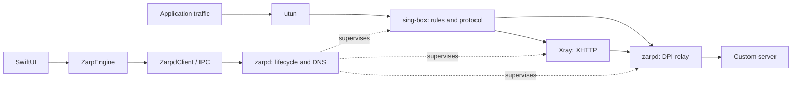

# Zarp: Windows, Android, and macOS comparison and feature parity plan

Audit date: **October 13, 2026**, Europe/Moscow.

**Main finding:** macOS already implements the basic WARP workflow, its own MASQUE client, strategy discovery, double verification, saved results, and connection recovery. The main gap emerged after the Windows and Android updates on October 10-12: custom servers, subscriptions, XHTTP/ECH, strategy/server pair selection, routing, GeoIP/GeoSite, application selection, and country-based strategy filtering.

For macOS, the recommended sequence is to complete portable WARP capabilities first, then add server mode and traffic rules. Reproducing all Windows packet techniques requires separate research: ordinary macOS sockets do not perform every WinDivert operation. These tasks are included in the plan but separated from the main product parity scope.

## 1. Compared versions

| Project | Local directory | Verified snapshot | Commit date |
|---|---|---|---|
| Windows | `_reference/Zarp` | `07406eb5af0a2ad1812fde3692965313cc2798fc`, tag `v1.5.0` | 2026-10-11 |
| Android | `_reference/Zarp-Android` | `9399fd496bb1fb791f83f4cb80a2f450186be31d`, tag `v1.1.1` | 2026-10-12 |
| macOS, working project | Project root | `f942a4bf4b9550bbdf63d5ee9e45791c1ee08216`, tag `v0.2.0` | 2026-10-08 |
| macOS, GitHub main | `_reference/Zarp-MacOS` | `dca673a4df1e6d18999675f2f88b1f74922c305a`, app version `0.2.0` | 2026-10-08 |

Windows and Android were updated from the requested `ZarpVPN/Zarp` and `ZarpVPN/Zarp-Android` repositories with full history and tags. The pinned Android `hev-socks5-tunnel` submodule and its dependencies were also obtained. These reference checkouts have clean working trees.

The `_reference/` directory was already in `.gitignore`; the existing rule was retained and an explanatory comment added. The new macOS checkout and local audit materials are covered by the same rule.

Local and remote macOS have different commit SHAs, **but the same Git tree**:

```text
38305f39835a617166da2e80a0317b6e8cfac801
```

The remote `v0.2.0` tag still points to the local `f942a4b`; remote main has a different history with identical content. The working checkout is therefore not behind in functionality. The working macOS application source was not changed during the audit.

Full SHAs, commit history, change statistics, strategy identifiers, and verification limits are recorded in [parity-snapshot.json](parity-snapshot.json). Tags identify source snapshots here; publication of GitHub Releases was not independently checked.

### Method and confidence

The audit examined Git history, networking engines, settings models, parsers, search algorithms, IPC, routing, lifecycle, UI, tests, and build scripts. READMEs were used alongside source code, rather than as the sole evidence of a feature.

During the audit, `make test` was run on the current macOS project: Go formatting/vet/race checks passed, and **175 Swift tests passed with no failures**. The initial attempt was restricted by a sandbox that prohibited creating local sockets; the rerun with access to loopback and Unix sockets succeeded. VPN, system routes, and DNS were not changed. Full log: `_reference/analysis-evidence/macos-local-tests.log`.

Windows and Android test suites were not executed during this audit. Their code and the authors' recorded results were reviewed. A catalog entry or localhost test does not establish successful bypass of an ISP's real DPI.

## 2. Changes across the projects

### 2.1. Windows

From the previous local `faf5515` snapshot of September 25 to `07406eb`: **14 commits, 84 changed files, 38,266 added lines, and 518 deleted lines**. Of the added lines, 20,691 belong to bundled country IP lists; diff size is not the amount of new application logic.

| Period / commit | Additions or changes | Relevance to macOS |
|---|---|---|
| September 24-25, initial versions through `c3d8b46` | One-button WARP, UI/tray, quick/full scans, eight languages, close behavior | Mostly implemented already |
| October 5, `1710a0c`, `02f4192`, tag `v1.2.0` | Discovery of installed WARP and consent-based installation of the official client; signature validation through WinVerifyTrust | The independent macOS client already solves the missing-WARP problem differently |
| October 6, `fefdc55`, then test fixes through `a82a942`, tag `v1.3.0` | New DPI strategy set, removal of built-in WG and the direct control, search/result hardening, restrictions on testing through a foreign VPN | Update the catalog and port the new search rules |
| October 9, `17c9a74` | Dry-run retry for the specific Windows loader failure `0xC0000142` | Windows-specific fix; no literal port |
| October 11, `5bab0e3`, `da6133a`, tag `v1.4.0` | VLESS/Trojan/Hysteria2 through sing-box, TUN, Direct/Proxy/Block, GeoIP/GeoSite, per-app selection, countries, custom WARP endpoints; SOCKS5 server-probe fix | A substantial new feature group missing on macOS |
| October 11, `c0e06ce`, `07406eb`, tag `v1.5.0` | Strategy/server pairs, HTTPS subscriptions, XHTTP through Xray, ECH; license and test clarifications | The current primary reference for server mode |

New key modules: `ProxyProfile`, `ProxyConfig`, `ProxyRuntime`, `SingBox`, `Xray`, `XrayConfig`, `ServerPairs`, `Subscription`, `RoutingSettings`, `RouteRules`, `GeoData`, `GeoDat`, `InstalledApps`, `StrategyFilter`, and `EndpointParser`. The UI gained dedicated connection, routing, application, and Geo-source windows. Tests include real local protocol traffic, runtime, generated configurations, subscriptions, routing rules, and application selection. [W-profile], [W-runtime], [W-pairs], [W-routing], [W-subscription], [W-tests]

A material limitation: Windows routing and per-app selection work **only with a custom server**. In WARP mode, Zarp controls the official Cloudflare client without replacing its network stack. [W-connection]

### 2.2. Android

From the previous local `1b80c30` snapshot of September 25 to `9399fd4`: **3 commits, 121 changed files, 33,081 added lines, and 191 deleted lines**. Routing files and their manifest account for 20,710 added lines.

| Period / commit | Additions or changes | Relevance to macOS |
|---|---|---|
| September 25, `e5121a7` through `1b80c30` | Independent MASQUE/WARP without root or the official app, Android VPN, SOCKS/TUN, double verification, quick/full scans, eight languages | macOS already uses a similar independent-client model |
| October 10, `f4ab600`, tag `v1.0.0` | Custom servers, per-app selection, routing, Geo data, country filters, and endpoints | Add product capabilities while adapting networking to macOS |
| October 12, `e15b9db`, tag `v1.1.0` | Strategies for custom servers, pairs/fallback, XHTTP/ECH, subscriptions, server selection, strict imports, migrations, foreground service for long scans | A more complete reference for behavior and negative cases |
| October 12, `9399fd4`, tag `v1.1.1` | TTL test fix | The commit message and diff identify a test correction, not a new VPN feature |

Current Android links sing-box and Xray **inside the Go library**. The registered `zarp-dial` outbound and custom Xray dialer apply the strategy directly to server connections. Counters track connections, TLS splits, UDP fake flows/packets, and foreign connections. `strategyApplied()` prevents a pair from being marked as working when traffic passed without the required modification. [A-native], [A-dial], [A-xray], [A-factory]

Other substantial improvements:

- Subscriptions: save/refresh/delete, offline cache, stale-list refresh, and explicit server selection or Automatic.
- Two search policies: WARP retains a two-phase scan; server pairs are confirmed inline, and Quick Scan counts confirmed pairs.
- Nine unavailable built-ins were removed; TTL strategies depend on device capability probes.
- Imports and errors do not expose secret parameter values; settings/cache are stored atomically in private DataStore.
- A separate foreground service supports long connection checks without keeping an Activity visible.
- Routing and per-app selection also work in WARP mode because the application owns its VPN. This differs from Windows. [A-engine], [A-subscription], [A-store], [A-factory], [A-vpn], [A-proof]

The Android verification document contains a historical statement that changes were uncommitted/unpublished, even though the document is now included in the audited commit. Its results should be read as a record of earlier testing. The ignored device logs from that session are not present in the fresh Git checkout. [A-proof]

### 2.3. macOS

Its history contains 27 commits, with development focused primarily on an independent networking core:

- **September 25:** SwiftUI interface, Swift core, actor/Codable/cancellation and localization fixes. An approach intercepting the official WARP client through NetworkExtension was investigated.
- **September 26:** transition to `zarpd`, creating utun and connecting to WARP itself; device registration, MASQUE H3/H2, fake packets from the same UDP socket, TTL, TLS split/disorder, packet pump, IPC, and LaunchDaemon installation through SMAppService.
- **September 26 to October 6:** real Quick/Full Scan, persistence, and resource-loading fixes; GUI adoption of a daemon connection already alive after the GUI restarts.
- **October 8, `v0.1.0`:** public source snapshot with full-tunnel IPv4/IPv6, DNS management, crash-recovery journals, unsupported-strategy guards, and packaging.
- **October 8, `v0.2.0`:** improved DMG and README; application and daemon functionality remained the same as `0.1.0`. [macOS Changelog](../CHANGELOG.md), [development history](history/development-log.md)

This is a working foundation for further development: new capabilities can be added behind the existing `ZarpEngine -> ZarpdClient -> zarpd` boundary while retaining the UI and verified MASQUE backend. A full macOS application rewrite is unnecessary.

## 3. Architectural differences

| Area | Windows | Android | macOS |
|---|---|---|---|
| Application | C# / WinForms / .NET Framework 4.8 | Kotlin / Compose | SwiftUI / AppKit |
| WARP | Official client through `warp-cli` | Independent MASQUE / usque | Independent MASQUE / usque |
| DPI modification | winws2 + WinDivert intercept the connection | Wrappers around owned UDP/TCP sockets | `zarpd/warp`: owned UDP/TCP socket |
| Custom servers | sing-box; Xray for XHTTP, separate processes | sing-box and Xray in Go core | Absent |
| System tunnel | WARP adapter or sing-box TUN | VpnService + hev-socks5-tunnel | utun + CONNECT-IP packet pump |
| Traffic rules | sing-box, server mode | sing-box, including above WARP SOCKS | Full tunnel or diagnostic host route only |
| Elevated privileges | Application/driver | VPN permission, no root | Separate root LaunchDaemon; unprivileged GUI |
| Main project license | MIT | GPL-3.0 | MIT |

The current macOS `wireguard-go` library is used for **utun**, not as an implemented WARP/WireGuard transport. Its presence in `go.mod` does not establish WireGuard support. [macOS opener](../zarpd/daemon/opener.go)

## 4. User-facing feature matrix

"Present" means implemented in the audited source. It does not promise effectiveness on every ISP.

| Feature | Windows | Android | macOS | Required action |
|---|---|---|---|---|
| One button, quick/full scan, cancellation | Present | Present | Present | Preserve |
| Double verification, `connect + 4 * ping`, fallback | Present | Present | Present | Refine Quick Scan and endpoint independence |
| WARP over H3 and H2 | Present | Present | Present | Preserve |
| Independent WARP without official client | Absent | Present | Present | Already implemented |
| Eight languages and language selection | Present | Present | Present | Translate new screens/errors |
| Custom strategies | 3/4 columns | 3/4 columns | 3 columns only | Add countries and compatible imports |
| RU/IR/CN multi-country filter | Present | Present | Absent | Add models, UI, and filtering to all engine operations |
| Custom WARP endpoints, list, and pinning | Present, IPv4/IPv6 | Present, IPv4/IPv6 | IPC accepts restricted IPv4 override; no list/settings | Implement user workflow and IPv6 dialing |
| New ordinary QUIC fake and TLS split profiles | Present | Present | Partial | Add portable profiles |
| IP fragmentation and raw TCP techniques | Present through WinDivert | Absent from built-ins | Absent | Separate research into full Windows DPI parity |
| WG | Custom `wg` profiles | Not implemented | Not implemented | Separate custom-parity task; does not block the main stage |
| VLESS / Trojan / Hysteria2 | Present | Present | Absent | Import, backend, and real verification |
| WS / gRPC / HTTPUpgrade / Reality / Vision / Salamander | Present in applicable combinations | Present in applicable combinations | Absent | Parameter contracts and protocol tests |
| VLESS XHTTP | External Xray | Embedded Xray | Absent | Add a dedicated Xray backend/bridge |
| TLS ECH and XHTTP pins/names | Present | Present | Absent | Add without implicit fallback |
| HTTPS subscriptions and offline cache | Present | Present | Absent | Download, cache, refresh, cancellation |
| Automatic strategy/server pair selection | Present | Present | Absent | Extend candidates, results, selection, and scans |
| Explicit server selection / Automatic | Through specific pair selection | Separate persisted server selection | Absent | Adopt Android's clearer workflow |
| Direct/Proxy/Block and editable presets | Custom server | WARP and custom server | Absent | Rules and networking backend |
| GeoIP/GeoSite, `.dat`, custom URL | Custom server | WARP and custom server | Absent | Converter, downloader, cache |
| Selected applications only | Custom server, executable path | WARP and custom server, package | Absent | macOS process matching and .app/helper selection UI |
| Custom DNS and IPv6 policy | Custom server | Both modes | Fixed DNS and override on/off only | Explicit settings and a correct DNS data path |
| Real-traffic checks while Connected | Periodic HTTPS checks | Testing/connection checks; native tunnel events | Testing/connection checks, then status/ping | Add data-plane monitoring and network-change handling |
| Operation with the window closed | Tray | Service / application engine | Menu bar / daemon | Preserve and extend to the new backend |
| GUI recovery after crash | Runtime adoption | Engine lives outside Activity | Daemon adoption present | Extend existing status with server/pair identity |
| Startup / auto-connect | Present | Auto-connect / VPN lifecycle present | Present | Preserve across migrations |

Matrix sources: [W-config], [W-cat], [W-engine], [W-connection], [A-config], [A-cat], [A-engine], [A-factory], [A-vpn]; macOS [AppSettings](../Packages/ZarpCore/Sources/ZarpCore/Settings/AppSettings.swift), [EngineProtocols](../Packages/ZarpCore/Sources/ZarpCore/Engine/EngineProtocols.swift), [ZarpEngine](../Packages/ZarpCore/Sources/ZarpCore/Engine/ZarpEngine.swift), [IPC](../zarpd/ipc/protocol.go).

Shared limitations of the current server implementations: VMess, Shadowsocks, TUIC, arbitrary client JSON configurations, KCP, and Hysteria2 port hopping are outside the supported set. They are not required for the parity scope described here. [W-profile], [A-profile]

## 5. Exact DPI catalog comparison

| Project | Built-in entries | What the count means |
|---|---:|---|
| Windows | 19 | H3/H2 strategies including WinDivert operations; no built-in direct/WG |
| Android | 15 | 13 desync candidates + `direct`/`direct-h2`; three TTL-dependent profiles are device-gated |
| macOS | 20 | 11 executable entries, including two direct controls; 9 unsupported entries |

Counts come from source catalogs, not READMEs. [W-cat], [A-cat], [macOS catalog](../Packages/ZarpCore/Sources/ZarpCore/Strategy/StrategyCatalog.swift)

### 5.1. Quick additions without a new packet backend

Four profiles are missing on macOS for parity with current Android:

| ID | Operation | Existing macOS primitive support |
|---|---|---|
| `warp-q-google12` | QUIC google fake x12 | `repeats` already supported |
| `warp-t-split-host` | `multisplit:pos=1,host` | `host` already supported |
| `warp-t-split-sld` | `multisplit:pos=1,sld` | `sld` already supported |
| `warp-t-split-endhost` | `multisplit:pos=1,endhost` | `endhost` already supported |

Windows additionally contains `warp-q-google11`, another portable repeat variant. Adding these five entries produces **16 executable candidates** if the available macOS controls and Android variants are retained. This counts executor capabilities, not proven DPI bypasses.

The Windows catalog cannot simply replace the macOS catalog: Windows lacks some useful Android candidates, and current `zarpd` cannot execute some Windows candidates. A combined catalog with an explicit capability matrix is needed.

### 5.2. Entries that require more than a catalog change

A dedicated packet backend or research into exact semantics is needed for:

- `warp-q-ipfrag8`, `warp-q-fake-ipfrag`: fragmentation of the real UDP/IP packet.
- `warp-t-google-md5`, `warp-t-seqovl`, `warp-t-disorder-seqovl`, `warp-t-vk-seq`, `warp-t-hostfake`, `warp-t-fake-multi`: TCP option/sequence/ack modification, overlap, and handshake-content substitution.
- `warp-t-multidisorder`: extended SNI markers and exact reverse-order segment transmission. Current macOS `disorder` uses a low TTL for the first segment and kernel retransmission; it does not implement full WinDivert multidisorder semantics. [W-cat], [macOS TCP executor](../zarpd/warp/desync.go)

The macOS parser understands `host`, `endhost`, `sld`, `midsld`, and numeric positions, but not `sniext+1`, `host+1`, `midsld-2`, or other computed Windows markers. Extending the parser alone does not implement the raw-packet technique. [StrategyArgsParser](../Packages/ZarpCore/Sources/ZarpCore/Strategy/StrategyArgsParser.swift), [IPC validation](../zarpd/ipc/validate.go)

Built-in WireGuard profiles were removed from current Windows and Android; Android also removed raw-only profiles. Restoring the four old built-in WG entries is therefore not the first parity step. Windows custom WG strategies remain a separate real functionality difference.

## 6. Gaps in existing macOS code

These findings follow from the current logic. They do not claim that every scenario was reproduced on a live network during this audit.

### 6.1. Quick Scan stops before confirmations

In macOS `searchAndApply()`, the first phase stops after `stopAfterWorking` initial successes, then rechecks only those candidates. For example, with a limit of 3 and three initial successes, two of which fail rechecking, the search ends with one confirmed result without continuing through the remaining list.

Windows rechecks each candidate inline and counts **confirmations**. Android does the same for server pairs while preserving the previous two-phase WARP flow. The proposal for macOS is an explicit updated Quick Scan rule: continue until N confirmations or list exhaustion. [macOS scan](../Packages/ZarpCore/Sources/ZarpCore/Engine/ZarpEngine.swift), [W-engine], [A-engine]

### 6.2. Two successes do not necessarily mean different endpoints

macOS stores only `confirmed` and the final `endpoint`. Windows separately stores `Independent` and `EndpointReused`.

The macOS `isolated-N` token is unique, but its endpoint pool is finite: H2 has only two IPs on TCP/443. A reachable example with two H2 candidates rechecked in the same order:

```text
First phase: split    -> isolated-0 -> 162.159.198.1:443
             disorder -> isolated-1 -> 162.159.198.2:443
Recheck:     split    -> isolated-2 -> 162.159.198.1:443
             disorder -> isolated-3 -> 162.159.198.2:443
```

Connections are fresh, but each candidate uses the same endpoint twice. `TestResult.confirmed()` still sets `confirmed=true`. Store two distinct properties: two successful connections and an independent check on another endpoint. With a custom server, both connections usually target the same server and should not be described as independent WARP endpoint tests. [endpoints](../zarpd/daemon/endpoints.go), [TestResult](../Packages/ZarpCore/Sources/ZarpCore/Results/TestResult.swift), [W-config]

### 6.3. The fourth custom-strategy column is incompatible

macOS splits a line using `maxSplits: 2`. A modern `Name | h2 | arguments | ru,ir,cn` line leaves `| ru,ir,cn` inside the arguments and produces an unknown-option error. Parse up to four fields while preserving the old three-column format. [CustomStrategyFile](../Packages/ZarpCore/Sources/ZarpCore/Strategy/CustomStrategyFile.swift)

### 6.4. Custom strategy identity depends only on its name

macOS uses `custom-` plus the normalized name. Changing arguments without changing the name retains the same ID and can preserve results from the previous technique. Windows moved to a hash of name, transport, and arguments, excluding countries; Android still uses the name.

Port the stronger Windows model and additionally store the executable configuration fingerprint in the result. Migrate legacy IDs only when the match is unambiguous. Country-tag changes must not invalidate results. [CustomStrategyFile](../Packages/ZarpCore/Sources/ZarpCore/Strategy/CustomStrategyFile.swift), [W-cat], [A-cat]

### 6.5. Status/ping do not verify user traffic

`AppViewModel.monitorTick()` performs daemon ping, reconciliation, and log retrieval. This checks processes and the known session but does not issue a new HTTPS probe through the connection. A live MASQUE session with a failed data plane can remain displayed as Connected for some time.

Add bounded real-traffic checks and network-change/sleep-wake notifications. Existing macOS reconnect makes three attempts with the same strategy and 2/10/30-second backoff, with a cycle limit; extend it while preserving protection against endless rescans. [AppViewModel](../App/Sources/Zarp/AppViewModel.swift), [ZarpEngine](../Packages/ZarpCore/Sources/ZarpCore/Engine/ZarpEngine.swift), [W-engine]

### 6.6. The network contract is deliberately WARP-specific

`prepare()` always checks the WARP account, `WarpMeasurement` requires `warp=on/plus`, `OpenParams` only contains MASQUE parameters, and endpoints are restricted to IPv4 and permitted WARP ranges/ports. DNS is fixed. These constraints cannot be bypassed by inserting a VLESS profile into an existing WARP open request.

Introduce separate mode, server-profile, probe-result, and validated-open types. Preserve protection of existing WARP requests. [EngineProtocols](../Packages/ZarpCore/Sources/ZarpCore/Engine/EngineProtocols.swift), [IPC protocol](../zarpd/ipc/protocol.go), [IPC validation](../zarpd/ipc/validate.go), [DNS](../zarpd/route/dns.go)

## 7. Proposed architecture

### 7.1. Preserve the application/daemon boundary

The application manages settings, profiles, subscriptions, candidates, and UI. `zarpd` owns the network session, outbound socket binding to the physical interface, backend lifecycle, DNS, and system-state recovery. The existing WARP backend remains an independent implementation.

The new contract should include `ConnectionMode`, `ServerProfile`, `StrategyServerPair`, `ConnectionOptions`, `ProbeKind`, `RuntimeCapabilities`, and a configuration fingerprint. Increment the IPC version for incompatible changes; `ping/status` reports capabilities and active mode/profile/pair. An incompatible daemon must not receive a new-format request.

### 7.2. Primary proof-of-concept candidate

Investigate **separate sing-box/Xray processes supervised by zarpd**, with a small independently implemented DPI relay for their outer connection. sing-box implements protocols and rules; Xray is added for XHTTP; the relay owns the final TCP/UDP sockets to the server.



This is **a proposal requiring a PoC**, not an already verified macOS backend. sing-box documents `detour`; version `1.13.14` forwards both `DialContext` and `ListenPacket` to the selected outbound. A local SOCKS5 transport relay is therefore a justified candidate. Compatibility with Hysteria2, UDP, MTU, and every XHTTP mode still needs to be demonstrated. [sing-box dial options](https://github.com/SagerNet/sing-box/blob/v1.13.14/docs/configuration/shared/dial.md), [DetourDialer](https://github.com/SagerNet/sing-box/blob/v1.13.14/common/dialer/detour.go)

The relay must sit **below the server protocol's transport** so that split/fake modifies the server's outer TLS/QUIC handshake. A SOCKS bridge above user traffic does not solve this by itself. Verify transport-level detour separately for the selected Xray version. Android uses a custom in-process dialer; it is not a ready-made solution for an external macOS process. [A-native], [A-xray], [Xray system dialer](https://github.com/XTLS/Xray-core/blob/v26.9.30/transport/internet/system_dialer.go)

Each new TCP connection requires splitting the first complete ClientHello; each new UDP flow requires fakes and real datagrams from the same outbound socket. The relay must assemble ClientHello correctly even across multiple reads, account for visible outer SNI with ECH, and expose counters of the modification actually applied.

### 7.3. Ownership of utun, DNS, and exclusions

In server mode, only one component owns utun and routes. For the first PoC, test sing-box TUN with lifecycle managed by `zarpd`; do not start the old MASQUE packet pump in that mode. An independent TUN frontend would require a separate L3-to-SOCKS/netstack implementation: the current packet pump passes IP into CONNECT-IP and is unsuitable for VLESS/Trojan.

Retain DNS backup and the crash journal regardless of which component owns TUN. Relay, sing-box, and Xray connections to the server stay outside their own tunnel; verify physical interface binding rather than relying only on one route exclusion. A startup failure in any component terminates the session and restores DNS/routes.

Do not copy Windows `strict_route` behavior mechanically to macOS: the documentation describes its effects on Linux/Windows, while the Apple NetworkExtension client marks it unsupported. Verify the DNS path and cleanup independently. [sing-box TUN](https://github.com/SagerNet/sing-box/blob/v1.13.14/docs/configuration/inbound/tun.md), [Apple client features](https://github.com/SagerNet/sing-box/blob/v1.13.14/docs/clients/apple/features.md)

### 7.4. macOS per-app routing: a capability requiring its own PoC

sing-box `1.13.14` route-rule documentation supports `process_name`, `process_path`, and `process_path_regex` on macOS. Its Apple NetworkExtension client cannot use process matching because of permissions. These are different execution models; restrictions on the sandboxed client do not prove that a root daemon cannot perform process routing. [route rule](https://github.com/SagerNet/sing-box/blob/v1.13.14/docs/configuration/route/rule.md), [Apple client features](https://github.com/SagerNet/sing-box/blob/v1.13.14/docs/clients/apple/features.md)

Run the PoC in the actual root LaunchDaemon model, using a browser, CLI, and an application with helpers. Build the user-facing application list only after proving TCP/UDP ownership detection. A bundle ID or .app path is not the path of a network helper process.

### 7.5. Licensing affects integration choices

macOS is currently MIT; Android core is GPL-3.0, and sing-box is GPL-3.0-or-later. Windows runs separate sing-box `1.13.14` and Xray `26.7.28` processes; Android links sing-box `1.13.14` and Xray `26.9.30`. The macOS integration must explicitly pin versions and document notices, corresponding source, and distribution obligations. [W-notices], [W-singbox-fetch], [W-xray-fetch], [A-go-mod], [macOS provenance](ARCHITECTURE.md#11-licensing-and-provenance)

Separate processes are an architectural option, not automatic proof that every combination preserves MIT. Do not copy GPL Android core into MIT `zarpd` or directly link sing-box without addressing this decision. Android behavior can serve as a specification; implementation and licensing must be handled separately.

## 8. Detailed backlog

**P0** completes portable WARP parity and result correctness; **P1** covers the main new user-facing capabilities; **P2** is the separate Windows packet/WG parity effort. None of the tasks below describes an application change already implemented.

### T01. Current catalog, countries, and custom format - P0

**Outcome:** the same portable strategies are available on macOS, and RU/IR/CN filtering works in every workflow.

Work:

- Add the four missing Android profiles and Windows google x11; retain useful current socket-compatible profiles.
- Remove obsolete WG/raw-only built-ins from the primary list or put them in an explicitly unavailable advanced section. Continue explaining unsupported custom strategies.
- Add country tags and All/RU/IR/CN multi-select; following the current upstream specification, Google/TLS candidates cover all three countries and VK candidates cover RU only.
- Apply filtering to the table, Connect, auto-connect, quick/full scans, selected tests, rechecks, and fallback. Filtering must not delete hidden results.
- Support the fourth custom-file column while preserving three-column compatibility; changing tags alone preserves identity.

Files: [Strategy](../Packages/ZarpCore/Sources/ZarpCore/Strategy/Strategy.swift), [StrategyCatalog](../Packages/ZarpCore/Sources/ZarpCore/Strategy/StrategyCatalog.swift), [CustomStrategyFile](../Packages/ZarpCore/Sources/ZarpCore/Strategy/CustomStrategyFile.swift), [AppSettings](../Packages/ZarpCore/Sources/ZarpCore/Settings/AppSettings.swift), [ZarpEngine](../Packages/ZarpCore/Sources/ZarpCore/Engine/ZarpEngine.swift), [StrategiesView](../App/Sources/Zarp/Screens/StrategiesView.swift). New small models: `StrategyCountry` / `StrategyFilter`. References: [W-cat], [W-filter], [A-cat], [A-filter].

**Acceptance:** old custom files load unchanged; new four-column files execute the original arguments; RU+CN produces the candidate union; country selection excludes direct profiles; unsupported techniques do not run as empty direct strategies. Country tags are not presented as evidence of effectiveness on every ISP.

### T02. Confirmation, independence, and result migration - P0

**Outcome:** Quick Scan finds the configured number of confirmed candidates, and a saved success belongs to the executable configuration.

Work:

- Use inline rechecks or continue the two-phase scan when confirmations are insufficient. New server mode uses inline confirmation.
- Separate `confirmed`, `independent`, and `endpointReused`; add first/final actual endpoints and a configuration fingerprint.
- Where possible, select a different endpoint for rechecking; report pool exhaustion and a single custom address honestly.
- Move custom IDs to a name/transport/arguments fingerprint, with unambiguous legacy-ID migration; validate saved latency/score bounds and arithmetic.
- Limit the outcome of selected tests to their candidates; separately allow saved fallback for normal Connect. Do not silently connect another previously tested entry after testing a selected subset.
- Do not record cancellation as failure or overwrite saved results from tests through a foreign VPN. Refuse server mode when another active VPN conflicts, as Android does.

Files: [TestResult](../Packages/ZarpCore/Sources/ZarpCore/Results/TestResult.swift), [ZarpEngine](../Packages/ZarpCore/Sources/ZarpCore/Engine/ZarpEngine.swift), [SettingsStore](../Packages/ZarpCore/Sources/ZarpCore/Settings/SettingsStore.swift), [endpoints](../zarpd/daemon/endpoints.go). References: [W-config], [W-engine], [A-engine].

**Acceptance:** three initial successes, two failed rechecks, and working entries later in the list cause the scan to continue; repeated H2 endpoints are not independent; old JSON loads; argument changes invalidate prior confirmation; country filtering retains other countries' history; cancellation preserves the previous valid result.

### T03. Custom WARP endpoints - P0

**Outcome:** users save an address list, scan it, and connect using the last endpoint that actually passed confirmation.

Work:

- A field accepting `IPv4:port` / `[IPv6]:port` lines, comments, numeric IP validation without DNS, deduplication, and Reset.
- Store the list and pinned endpoint; list changes invalidate related results.
- Use the list for initial checks, rechecks, and persistent connections. One address means a fresh connection, not endpoint independence.
- Implement IPv6 control connections across the entire path: validator, resolver, `udp6`/`tcp6`, interface binding, fake hop limits, and route exclusions. Existing IPv6 traffic inside the tunnel does not provide this.
- Give permitted custom addresses/ports a dedicated validated contract; do not disable all IPC validation. WARP connections retain their WARP TLS pin instead of becoming arbitrary server mode.

Files: [AppSettings](../Packages/ZarpCore/Sources/ZarpCore/Settings/AppSettings.swift), [ZarpdClient](../Packages/ZarpCore/Sources/ZarpdIPC/ZarpdClient.swift), [IPC validation](../zarpd/ipc/validate.go), [endpoints](../zarpd/daemon/endpoints.go), [opener](../zarpd/daemon/opener.go), [route exclusion](../zarpd/route/exclusion.go), [SettingsView](../App/Sources/Zarp/Screens/SettingsView.swift). References: [W-endpoints], [A-endpoints].

**Acceptance:** IPv4/IPv6 parsing is correct; an incompatible server fails WARP pin/probe verification; scans rotate the configured list; Connect uses a confirmed address; Reset restores the default pool; changing an address does not leave an old host route.

### T04. Backend PoC and supervised external processes - P1

Dependency: the T05 profile format can be designed alongside the PoC; production runtime depends on a successful PoC.

**Outcome:** a custom server with a strategy is demonstrated on macOS under the selected licensing model.

Work:

- Pin sing-box/Xray versions and distribution method. Android Xray `26.9.30` is a reasonable candidate, but verify it on macOS rather than assuming it replaces Windows `26.7.28` automatically.
- Test external sing-box with a local transport relay: TLS split, Hysteria2 UDP fakes, SNI/ALPN, new connections, IPv4/IPv6, cancellation.
- Separately test Xray transport detour and XHTTP H3; a user-traffic SOCKS bridge is not proof of handshake strategy application.
- Test selected-app process rules under the root daemon and actual TUN/DNS/route cleanup.
- Implement a supervisor: start/check/stop, readiness, bounded diagnostics, child ownership, GUI-crash recovery, and teardown of incomplete chains.
- Load binaries only from predefined paths/a signed bundle and verify versions/integrity. IPC does not accept commands, arbitrary argv, or arbitrary binary/configuration paths.
- Local relays/bridges listen only on loopback, use unique authentication, a session-fixed target, and a bounded lifetime; secret configuration has restricted access and is cleaned up.

Files: new `zarpd/proxy` / `zarpd/relay`, [manager](../zarpd/daemon/manager.go), [daemon main](../zarpd/cmd/zarpd/main.go), [IPC](../zarpd/ipc/protocol.go), [project.yml](../project.yml), [package.sh](../scripts/package.sh). References: [W-runtime], [W-proxy-config], [A-native], [A-dial], [A-xray].

**Acceptance:** a real local server carries TCP and UDP; packet capture/counters prove modification of the outer connection; every new flow receives the technique; incorrect pins/credentials fail; cancellation and failures clean up all child processes and network changes. A failed PoC requires a different backend, not a nominally working catalog entry without desync.

### T05. Shared connection models, imports, and IPC - P1

**Outcome:** WARP and custom servers have separately validated modes, and the UI receives actionable import errors.

Work:

- Introduce mode, profile/source/server identity, outer transport, server selection, typed connection options, and capabilities.
- Strictly parse `vless://`, `trojan://`, `hysteria2://` / `hy2://`: UUID/password, host/port, TLS/SNI/ALPN, TCP/WS/gRPC/HTTPUpgrade, Reality/Vision, and Salamander in applicable combinations.
- Errors name the field/protocol, not its value. Do not silently ignore unknown parameters or log complete URIs.
- Server identity follows the configuration without its fragment label; renaming a label does not invalidate verification.
- Add schema migration preserving language, autostart, WARP account/terms, routing defaults, and valid old strategy history.
- Extend IPC version, runtime status, and client. The server model does not weaken the WARP validator.
- Do not register a WARP device or request WARP terms in server mode; separate WARP trace probes from real HTTPS through a custom server.

Files: [AppSettings](../Packages/ZarpCore/Sources/ZarpCore/Settings/AppSettings.swift), [EngineProtocols](../Packages/ZarpCore/Sources/ZarpCore/Engine/EngineProtocols.swift), [SettingsStore](../Packages/ZarpCore/Sources/ZarpCore/Settings/SettingsStore.swift), [ZarpdClient](../Packages/ZarpCore/Sources/ZarpdIPC/ZarpdClient.swift), [IPC protocol](../zarpd/ipc/protocol.go), [IPC validation](../zarpd/ipc/validate.go). New models: `ServerProfile`, `ConnectionMode`, `ConnectionSource`. References: [W-profile], [A-profile], [A-store].

**Acceptance:** shared link vectors receive the same interpretation on macOS and the references; invalid URIs do not expose passwords; incompatible IPC returns an understandable error; server mode works without a WARP account; label changes preserve identity while credentials/transport changes do not.

### T06. Server mode and pair discovery - P1

Depends on T04/T05 and the T02 confirmation rules.

**Outcome:** Connect selects a working strategy/server pair and reuses it on subsequent launches.

Work:

- Generate `strategyId@serverId`; pair TLS/Reality TCP connections with TLS split, and Hysteria2/XHTTP with ALPN exactly `h3` with UDP fake strategies.
- Exclude unsupported, WG, and normal WARP direct controls from desync pairs. Check compatibility before expensive startup.
- Follow strategy-major order: test suitable servers for a strategy, then move to the next strategy.
- Stop on the first failed HTTPS request; confirm successes with fresh connections and measure latency through the server.
- Measure connection time through the first successful HTTPS response, not process startup alone; merge with `max(connect)` and average the two ping results.
- Connect order: selected pair, confirmed pairs by score, then scan; do not rescan the sole already-failed pair without a reason.
- Resolve servers before TUN and cache DNS successes/failures per operation. Editing settings or refreshing sources does not replace the active pair.
- Run a post-TUN probe; if the actual route fails, stop the entire chain and restore direct connectivity.
- As a separate Android-parity setting, provide Allow a connection without a strategy, disabled by default and shown with a yellow status; a plain connection is not DPI bypass.

Files: [Strategy](../Packages/ZarpCore/Sources/ZarpCore/Strategy/Strategy.swift), [ZarpEngine](../Packages/ZarpCore/Sources/ZarpCore/Engine/ZarpEngine.swift), [TestResult](../Packages/ZarpCore/Sources/ZarpCore/Results/TestResult.swift), [manager](../zarpd/daemon/manager.go), new `ServerPairs` and server probe. References: [W-pairs], [W-engine], [A-pairs], [A-engine], [A-factory].

**Acceptance:** a test model with one working pair selects it; incompatible combinations never create candidates; fallback follows score order; a server trace with `warp=off` is acceptable when proxy traffic is real; an empty/direct response without proxy traversal fails; failed adapter startup leaves the network working.

### T07. Subscriptions and server selection - P1

Depends on T05/T06; downloader/cache models can be implemented before the TUN backend is ready.

**Outcome:** a subscription URL replaces manual single-server entry, with operation from the last valid cached list.

Work:

- HTTPS-only URLs without userinfo/fragment; plain lists and standard/URL-safe base64, including supported unpadded forms.
- 200 distinct servers, 2 MiB after decompression, up to five HTTPS-only redirects, and one 25-second deadline across both user-agent attempts.
- Retry as `v2rayN` only for an unsuitable response format, not to disguise an ordinary network failure.
- Count unsupported/refused/excess entries; separately explain HTML/JSON responses instead of a link list.
- Atomic source-hash-bound cache; Save/Refresh/Delete, refresh on connect after 12 hours, and retention of the previous list if refresh fails.
- Persist Automatic/specific server ID; a disappeared selection remains unavailable until the user changes it instead of silently switching servers.
- Refresh does not change the active pair; removing/changing one profile invalidates only its pairs. Source/mode changes clear related selected/results state.
- Store source/credentials in restricted local storage; choose Keychain for secrets or a documented protected file store on macOS.

Files: new `SubscriptionDownloader`, `SubscriptionSnapshot`, `ServerRepository`; [SettingsStore](../Packages/ZarpCore/Sources/ZarpCore/Settings/SettingsStore.swift), [AppViewModel](../App/Sources/Zarp/AppViewModel.swift). References: [W-subscription], [A-subscription], [A-downloader], [A-store].

**Acceptance:** offline restart uses the previous list; timeout/cancel/oversize/bad TLS preserve cache; redirects to HTTP are rejected; fragment-label changes preserve server ID; a disappeared explicit selection does not choose another server; URL tokens never appear in UI errors/logs.

### T08. XHTTP, ECH, and complete server-parameter compatibility - P1

Depends on T04-T06.

**Outcome:** macOS accepts XHTTP/ECH links supported by current Windows/Android and actually carries traffic with the selected strategy.

Work:

- XHTTP for VLESS only, `encryption=none`, empty flow, `auto` / `packet-up` / `stream-up` / `stream-one` modes, path/host, extra/xmux/padding.
- TLS/Reality, SNI, ALPN, fingerprint, `pcs` pins, and `vcn` names; Reality `pbk/sid/spx/pqv`. Reject enabled allowInsecure for current Xray; trust self-signed certificates through explicit pins.
- `extra` takes precedence over `x_padding_bytes`; empty optional values mean absence.
- Validate ECH as an ECHConfigList and allow it only with TLS; incorrect configuration never downgrades to ordinary TLS. sing-box uTLS fingerprints do not apply with ECH.
- XHTTP H3 is selected only by ALPN `[h3]`. Do not describe other lists as QUIC; UDP destinations inside XHTTP remain inside its streams.
- Match the stricter Android behavior: permit `downloadSettings` only for the same paired host/port/outer transport with appropriate TLS/Reality configuration; reject incompatible stream-one/downloadSettings.
- For CLI Xray, verify the transport relay chain on every connection. Add counters to verify applied strategy.
- Reject unknown `fm`, legacy `splithttp`, port hopping, and arbitrary client JSON rather than presenting them as supported links.

Files: server parser/configuration builder, `zarpd/proxy/xray`, `zarpd/relay`, new contract fixtures. References: [W-profile], [W-xray-config], [A-profile], [A-xray], [A-contracts], [A-connection].

**Acceptance:** real local Xray servers carry TCP/UDP in every supported mode; incorrect pin/ECH/Reality key never reports Connected; same-server downloads work and secondary targets are rejected; captures/counters show outer-session TLS splits/UDP fakes; diagnostics expose no secrets or destination details.

### T09. Direct / Proxy / Block and presets - P1

Depends on a working T04/T06 server backend. WARP support also depends on T12.

**Outcome:** users choose which traffic goes directly, through the tunnel, or is blocked.

Work:

- Settings/preset models: LAN/RU/IR/CN, custom presets, edit/reset/delete.
- Parse `geoip:`, `geosite:`, `domain:`, `full:`, `keyword:`, `regexp:`, and IP/CIDR; skip blank/comment lines and include line numbers in errors.
- Compile with Block > Proxy > Direct priority and verify matching against the actual backend.
- Adopt Windows LAN-direct fallback after explicit user rules as a desktop policy. Enabled Block/Proxy rules must not be bypassed by LAN route exclusions.
- With rules disabled, preserve existing macOS full-tunnel behavior; new defaults do not silently change old settings.
- DNS hijack/reverse mapping and HTTP/TLS/QUIC sniffing; explain domain-rule limits when DNS/ECH hides the domain.
- Force the probe ingress/check through the target tunnel before user bypass rules, so Direct cannot certify a failed proxy.

Files: new `RoutingSettings`, `RoutingPreset`, `RouteRuleParser`, `RoutingView`, and proxy configuration compiler; [AppSettings](../Packages/ZarpCore/Sources/ZarpCore/Settings/AppSettings.swift), [SettingsView](../App/Sources/Zarp/Screens/SettingsView.swift). References: [W-routing], [W-rules], [W-proxy-config], [A-routing], [A-geodata].

**Acceptance:** overlapping Block/Proxy/Direct rules follow priority; printer/router access works with the LAN preset; explicit LAN Block cannot be bypassed; invalid rules are not skipped; probes stay tunnel-only; rule changes take effect on reconnect without disrupting the active session.

### T10. GeoIP / GeoSite and `.dat` downloads - P1

Depends on T09.

**Outcome:** geographic/domain categories work with the same user-defined sources as the references.

Work:

- Parse V2Ray/Xray `.dat` protobuf and convert it into native rules/rule-sets. Do not use removed legacy sing-box `geoip/geosite` fields.
- Custom HTTPS URLs, explicit Download/Update, 64 MiB and three-minute limits, HTTPS-only redirects, cancellation.
- Validate the entire file before atomic replacement; source-specific caches; failed updates preserve the last valid database.
- `geosite:group@attribute` / `@!attribute`, IPv4/IPv6 GeoIP, built-in private.
- RU/IR/CN fallback data from CC0 ipverse for the default source until GeoIP is downloaded; custom sources require their own database; GeoSite requires a download.
- Pin the bundled lists' revision/SHA-256 and license source.
- Load large databases through managed storage instead of sending entire `.dat` files or tens of thousands of CIDRs in a small IPC request. The daemon accepts permitted cache identifiers, not arbitrary filesystem paths.

Files: new `zarpd/geodata`, application downloader/cache UI, assets/routes, [IPC limits](../zarpd/ipc/server.go). References: [W-geodata], [W-geodat], [A-geodata], [A-connection].

**Acceptance:** unknown categories or missing databases stop connection with an explanation; malformed records/oversize/timeout preserve the working database; changing URL does not reuse another source's cache; every domain-record type and attribute passes contract checks.

### T11. macOS application selection - P1

Depends on the T04 process-matching PoC and T09 rules. WARP support depends on T12.

**Outcome:** selected applications use the tunnel while the others connect directly.

Work:

- Inventory .app bundles in system/user Applications, running applications, and manually added paths.
- Names, icons, search; retain bundle identity and permitted executable/helper paths.
- Identify actual Chromium/Electron/WebKit network helpers and verify limits of shared system processes; a bundle ID alone is not a sufficient network match.
- Backend process rules and fixed bypass for the outer transport runtime; health probes use the target tunnel regardless of application selection.
- Empty/stale selections must not become all applications; an unknown process owner must not become global proxying.
- Recompute matching after .app updates/moves; do not copy Windows case-insensitive path policy without accounting for the macOS filesystem.

Files: new `InstalledApps` / `AppRoutingSettings` / `AppsView`, proxy configuration compiler, [AppViewModel](../App/Sources/Zarp/AppViewModel.swift). References: [W-apps], [W-proxy-config], [A-vpn], [A-apps-ui].

**Acceptance:** the selected browser and its helpers use the proxy exit IP while an unselected CLI is direct; test UDP separately; measure selected/excluded app DNS behavior; a removed application does not enable a global tunnel; the runtime never loops into itself.

### T12. Routing and per-app policies above WARP - P1

Depends on T04/T09; part of the work overlaps with T11.

**Outcome:** macOS achieves Android parity in WARP mode, beyond Windows custom-server parity.

macOS MASQUE currently returns IP packets and pumps them between CONNECT-IP and utun. Android MASQUE exposes SOCKS5, above which `ProxyTunnelFactory` inserts routing. **macOS has no ready-made SOCKS adapter to MASQUE.** Building one is a separate task, not a sing-box configuration switch. [macOS packet pump](../zarpd/tunnel/tunnel.go), [A-factory]

Work:

- Separate the MASQUE session from its existing system TUN frontend.
- Validate an appropriately licensed L4 adapter/netstack that exposes TCP/UDP SOCKS access to the MASQUE IP session.
- Connect policy TUN -> routing engine -> WARP SOCKS adapter -> MASQUE. One policy frontend owns system routes; Direct uses the physical interface.
- Isolate WARP control traffic from rules, endpoint exclusions, and per-app selection; preserve endpoint pinning and fake-packet socket semantics.
- Retain the previous simple full-tunnel path with policies disabled if that preserves verified behavior and reduces migration risk.

Files: [warp session](../zarpd/warp/dial.go), [opener](../zarpd/daemon/opener.go), [tunnel](../zarpd/tunnel/tunnel.go), [full tunnel routes](../zarpd/route/fulltunnel.go), new `warp/socksadapter` / netstack frontend. References: [A-factory], [A-core-proxy].

**Acceptance:** WARP probes report `warp=on/plus` through the adapter; Direct/Proxy/Block and application selection also work with WARP; TCP/UDP/IPv6/DNS work; no competing second full tunnel exists; disabling rules restores ordinary WARP; crash recovery works in both models.

### T13. DNS, IPv6, and connection resilience - P1

**Outcome:** clear network settings and timely detection of lost traffic, including sleep and interface changes.

Work:

- Custom DNS and IPv6 policy; separate server-address bootstrap DNS from destination DNS inside the tunnel.
- Disabling tunneled IPv6 must not silently permit IPv6 leaks for selected proxy traffic; follow the explicit policy and verify IPv4 fallback.
- Bounded HTTPS health checks within the active session, without Direct-rule bypass; do not race them against teardown/scanning.
- Debounced network-change/sleep-wake events; a new physical interface triggers correct route/DNS reconfiguration.
- Backoff/reconnect, active-pair retention, and user cancellation; distinguish network errors from permanently unsuitable strategies.
- Choose daemon-owned monitoring for connections that outlive the GUI; do not introduce competing GUI/daemon reconnect systems.
- Verify DNS backup/restore and journals after SIGTERM/kill -9 for new processes and bridges.

Files: [AppViewModel](../App/Sources/Zarp/AppViewModel.swift), [ZarpEngine](../Packages/ZarpCore/Sources/ZarpCore/Engine/ZarpEngine.swift), [SystemNetworkInspector](../App/Sources/Zarp/SystemNetworkInspector.swift), [manager](../zarpd/daemon/manager.go), [DNS](../zarpd/route/dns.go), [exclusion](../zarpd/route/exclusion.go). References: [W-engine], [W-proxy-config], [A-factory], [A-vpn].

**Acceptance:** data-plane loss removes false Connected status; manual Disconnect cancels pending reconnect; wake and Wi-Fi/Ethernet transitions leave no stale routes; daemon restart leaves no orphan children; original DNS is fully restored; keeping the VPN after GUI exit follows the configured setting.

### T14. New screens and localization - P1

Develop as contracts become ready; do not wait for the last networking stage.

**Outcome:** users can access new capabilities through normal settings rather than editing JSON or using CLI commands.

Work:

- Server/endpoints: source, Save/Refresh/Delete, validation/status, Automatic/server selection, WARP endpoint-list fields.
- Routing: presets, Direct/Proxy/Block editor, Geo sources/download state.
- Applications: searchable list, icons, selection, and helper explanations.
- Show pair, mode/protocol/security, confirmation, and endpoint independence in the list; plain status is yellow.
- Country multi-select, server-identity filtering, and manageable large pair lists; lazy rendering and cancellation.
- Explain mode-specific settings that do not apply: WARP endpoints/test isolation in server mode.
- Translate new text into all eight existing languages and extend key/placeholder checks; localized errors never reveal secrets.

Files: [SettingsView](../App/Sources/Zarp/Screens/SettingsView.swift), [StrategiesView](../App/Sources/Zarp/Screens/StrategiesView.swift), [MainWindowView](../App/Sources/Zarp/Screens/MainWindowView.swift), [AppViewModel](../App/Sources/Zarp/AppViewModel.swift), `Resources/Lang`; new focused views. References: [W-connection], [A-connection], [A-apps-ui].

**Acceptance:** every settings workflow is accessible by mouse/keyboard; background work does not block the UI; progress survives closing/reopening a screen; global Connect/Cancel remain predictable; long translations preserve layout; secret URIs never appear in tables/logs.

### T15. Contract tests, builds, and distribution - P1

Depends on the selected runtimes and configuration formats; extend it during every preceding stage.

**Outcome:** features are verified on macOS and pinned backends are reproducibly packaged with the application.

Work:

- Shared sanitized link/configuration fixtures for all three platforms; Android's 24 Kotlin/native JSON contracts can serve as configuration specifications subject to fixture licensing.
- Go: loopback VLESS/Trojan/Hysteria2/Xray servers, actual TCP/UDP, generated TLS/ECH/Reality keys; certificate-failure cases and cancellation.
- Swift: candidate universe, country/server filtering, confirmation/fallback, offline subscriptions, migrations, source refresh, and active-pair retention.
- Actual `sing-box check` / `xray ... -test` for generated configurations; validate against pinned versions, not moving latest.
- Supervisor/tampered-binary tests, IPC bounds, cleanup, and secret-free diagnostics; a separate root integration scenario on a Mac.
- Add pinned Darwin arm64 assets/builds, checksum verification, nested code signing, and notices for every shipped component.
- CI runs headless checks/builds. Real-Mac root/network checks stay separate from ordinary unit tests and are not declared complete merely because CI passes.
- Notarization and Intel/universal support can be separate distribution tasks when their prerequisites are available; they do not replace server/routing functional checks.

Files: [Swift tests](../Packages/ZarpCore/Tests/ZarpCoreTests/ZarpEngineTests.swift), [Go tests](../zarpd/daemon/manager_test.go), [integration script](../scripts/test-integration.sh), [CI](../.github/workflows/ci.yml), [project.yml](../project.yml), [packaging](../scripts/package.sh), [notices generator](../scripts/gen-notices.sh). References: [W-tests], [A-contracts], [A-proof].

**Acceptance:** ordinary tests require neither root nor VPN; tests actually run protocol engines and exchange traffic instead of checking JSON alone; the complete Mac scenario confirms tunneling, route/DNS restoration, and crash recovery; artifacts use pinned components and correct notices.

### T16. Full Windows packet parity and custom WireGuard - P2

These are two independent research tasks; the main server/routing release should not depend on them.

**Packet backend:** investigate UDP/IP fragmentation, TCP MD5/seq/ack/overlap/hostfakesplit, and exact multi-point disorder. Select a macOS mechanism: raw/BPF, an independent transport stack, or a system component, considering actual Darwin and signing capabilities. Verify IP/TCP checksums, sequence state, IPv4/IPv6, target scoping, and cleanup. There is no straightforward port of `winws2.exe` arguments.

**WireGuard:** for the complete Windows custom workflow, add an independent WG backend with the corresponding WARP registration/keys/settings and a custom bind that sends fakes before the real handshake from the required socket. Current `wireguard-go/tun` only provides TUN utilities. WG requires a technical PoC and current verification of WARP registration rather than blindly reusing MASQUE credentials.

**Research acceptance:** a controlled server and packet capture confirm the exact claimed packet modification; unrelated connections are untouched; transport operation is proven separately from DPI effect. Only then estimate production implementation. Effectiveness on a real ISP is verified separately.

## 9. Implementation order and intermediate outcomes

| Milestone | Tasks | User-visible outcome | Estimate for one developer |
|---|---|---|---|
| M1. Complete WARP parity | T01-T03 | Updated catalog, countries, custom fourth column, custom endpoints, honest confirmation | 6-10 working days |
| M2. Custom server with a strategy | T04-T06, initial T14 screens | VLESS/Trojan/Hysteria2, real TCP/UDP, pairs, fallback | 10-18 days |
| M3. Modern sources and transports | T07-T08 | Subscriptions, offline cache, server selection, XHTTP/ECH | 8-14 days |
| M4. Rules and Geo data | T09-T10 | Direct/Proxy/Block, presets, GeoIP/GeoSite, database downloads | 8-14 days |
| M5. WARP policies and applications | T11-T13 | Per-app/routing also for WARP; DNS/IPv6, resilience | 10-18 days |
| M6. Complete verification and distribution | Finish T14-T15 | Complete eight-language UI, runtime checks, reproducible DMG | 6-10 days |
| M7. Full Windows packet/custom WG parity | T16 | Additional low-level strategies and WG | PoC first; production estimate undetermined |

M1-M6 total: **48-84 working days**, approximately **10-17 weeks** for a developer familiar with Swift/Go and networking. This is an engineering estimate, not a deadline commitment. Allow additional contingency for macOS integration, external versions, and real network conditions. TUN/relay/process-matching PoCs may change the estimate. T16 research is excluded.

Documentation and UI are developed during each milestone. M6 completes overall verification rather than postponing every test until the end. The first delivery after this audit should reasonably contain M1 only: it provides immediate value without depending on a new proxy backend.

Main dependencies:

```text
T01 + T02 + T03                         -> improved WARP
T04 PoC + T05 models/IPC                -> T06 server pairs
T05 + T06                              -> T07 subscriptions
T04 + T05 + T06                         -> T08 XHTTP/ECH
T04 + T06                              -> T09 routing -> T10 Geo
T04 process PoC + T09                   -> T11 per-app (server)
T04 + T09 + MASQUE/SOCKS adapter T12     -> routing/per-app (WARP)
Every new runtime                      -> T13 resilience
Every milestone                        -> T14 UI + T15 verification/package
Separate packet/WG PoC                  -> T16
```

### Full-scan workload

Subscriptions multiply candidates. For example, 200 TLS servers and 5 portable TLS strategies produce 1,000 pairs. At a 15-second timeout for one failed initial attempt per pair, waiting alone takes 4 hours 10 minutes, excluding overhead. Full Scan should no longer be described as a guaranteed minute-long operation.

Use Quick Scan by default, clear pair counts/progress, early exclusion of incompatible profiles, resolve-once, working Cancel, and saved partial results. Parallel live scanning cannot simply be enabled: current macOS verification uses a system host route. Future concurrency first requires per-session SOCKS/probe isolation.

## 10. Minimum verification matrix for a new release

| Check | What it establishes | Verification method |
|---|---|---|
| Catalog / countries / custom | Correct arguments and filtering across actions | Swift unit cases and IPC fixtures |
| Quick Scan / confirmations | N confirmations, endpoint independence, correct cancellation | Scripted connection providers; finite endpoint pool |
| Imports | All supported link parameters and rejection of invalid combinations | Shared sanitized contract vectors |
| Server traffic | Actual TCP/UDP through VLESS/Trojan/Hysteria2 | Real local protocol engines |
| XHTTP/ECH/Reality | Actual traffic and rejection of invalid pin/ECH/key | Local Xray/TLS/QUIC and negative cases |
| Strategy application | Split/fake reaches every outer server flow | Capture or independent counters and a controlled peer |
| Subscriptions | HTTPS, redirects, compression, deadline, offline use, atomic cache | Local HTTPS fixtures and state tests |
| Rules / Geo | Priority, domain/IP/regexp/attributes, unknown categories | Actual backend and distinct Direct/Proxy marker endpoints |
| Per-app | Correct TCP/UDP owner, helpers, selected/excluded behavior | Real macOS applications and CLI |
| WARP policy | WARP traffic works after adding the L4 adapter | Actual WARP trace `on/plus`, UDP, IPv6 |
| DNS | Bootstrap/proxy DNS, rule path, exact restoration | Real Mac, observing resolution and configuration |
| Post-TUN probe | The adapter actually routes traffic without recursive tunneling | Exit comparison and physical outbound connection |
| Crash / shutdown / sleep | No orphan children, stale routes/DNS, or false Connected | SIGTERM/kill -9, GUI restart, sleep/wake, interface change |
| Migration | Preferences are retained and old state does not certify a new configuration | Old JSON and corrupted-state fixtures |
| UI / languages | Accessible features, Cancel/progress, hidden secrets | Eight languages, long labels, many pairs |
| Distribution | Pinned versions/checksums/signing/notices | CI build and final bundle/DMG inspection |

Existing tests and upstream records of past verification cannot justify a claim that every platform was tested during this audit.

macOS history records real WARP/full-tunnel/crash/DNS checks on macOS 15/Wi-Fi on October 8. It explicitly leaves sleep/wake, roaming, and some other configurations unverified. Android records phone checks for TLS XHTTP and Hysteria2/Salamander on Android 10, while some other parameters were tested on desktop. Windows has a real-adapter test, but ordinary runs skip it unless special conditions are met. These limitations remain part of the assessment. [macOS development evidence](history/development-log.md), [A-proof], [W-tests]

## 11. Definition of macOS parity

**Main product parity M1-M6** is achieved when users can:

1. Connect to WARP with current portable strategies, country filtering, and custom IPv4/IPv6 endpoints.
2. Import a supported VLESS/Trojan/Hysteria2/XHTTP link or HTTPS subscription and use offline cache.
3. Select a specific server or Automatic and obtain an actually verified pair whose strategy modifies its outer handshake.
4. Use TLS/ECH/Reality/applicable transports and receive correct rejection of invalid settings without exposing credentials.
5. Configure Direct/Proxy/Block, LAN/RU/IR/CN presets, GeoIP/GeoSite, and selected applications **in both server and WARP modes**.
6. Control DNS/IPv6, cancel long scans, close/reopen the GUI without losing the active pair, and recover correctly after network failure.
7. Upgrade from the old macOS version without losing ordinary preferences; previous-configuration results do not certify a new configuration.
8. Use a complete eight-language UI and receive a package containing verified runtime versions and appropriate notices.

**Full parity with Windows low-level capabilities** additionally requires T16. Without it, do not claim execution of all Windows raw profiles or its custom WireGuard workflow. Android does not have that full set either.

Windows MSI/WinVerifyTrust/Defender/WinDivert loader workarounds and Android adb/foreground-service APIs are platform-specific solutions rather than missing macOS features to port literally. Their macOS equivalents are reliable daemon installation/distribution, background lifecycle, and diagnosable connections. Returning to the official WARP client is not required by this plan.

## 12. Sources and navigation

Windows/Android source links are pinned to audited SHAs. Local macOS links point into the working project. During the audit, sing-box/Xray documentation was queried through Context7 and critical platform details were checked against official version-specific source. Context7 sometimes returned moving `testing/main` links; these were not treated as proof of pinned-backend behavior without additional verification.

| Area | Windows | Android |
|---|---|---|
| Settings | [W-config] | [A-config], [A-store] |
| Catalog and filtering | [W-cat], [W-filter] | [A-cat], [A-filter] |
| Engine | [W-engine], [W-pairs] | [A-engine], [A-pairs] |
| Endpoints | [W-endpoints] | [A-endpoints] |
| Imports / transports | [W-profile], [W-xray-config] | [A-profile], [A-contracts] |
| Runtime / networking | [W-runtime], [W-proxy-config] | [A-factory], [A-native], [A-dial], [A-xray], [A-core-proxy] |
| Subscriptions | [W-subscription] | [A-subscription], [A-downloader] |
| Rules / Geo / applications | [W-routing], [W-rules], [W-geodata], [W-geodat], [W-apps] | [A-routing], [A-geodata], [A-vpn], [A-apps-ui] |
| Contracts and evidence | [W-tests], [W-connection] | [A-proof], [A-connection] |
| Dependencies and notices | [W-singbox-fetch], [W-xray-fetch], [W-notices] | [A-go-mod] |

[W-config]: https://github.com/ZarpVPN/Zarp/blob/07406eb5af0a2ad1812fde3692965313cc2798fc/src/Zarp/Core/AppConfig.cs
[W-cat]: https://github.com/ZarpVPN/Zarp/blob/07406eb5af0a2ad1812fde3692965313cc2798fc/src/Zarp/Core/Strategy.cs
[W-filter]: https://github.com/ZarpVPN/Zarp/blob/07406eb5af0a2ad1812fde3692965313cc2798fc/src/Zarp/Core/StrategyFilter.cs
[W-engine]: https://github.com/ZarpVPN/Zarp/blob/07406eb5af0a2ad1812fde3692965313cc2798fc/src/Zarp/Core/Engine.cs
[W-pairs]: https://github.com/ZarpVPN/Zarp/blob/07406eb5af0a2ad1812fde3692965313cc2798fc/src/Zarp/Core/ServerPairs.cs
[W-endpoints]: https://github.com/ZarpVPN/Zarp/blob/07406eb5af0a2ad1812fde3692965313cc2798fc/src/Zarp/Core/EndpointParser.cs
[W-profile]: https://github.com/ZarpVPN/Zarp/blob/07406eb5af0a2ad1812fde3692965313cc2798fc/src/Zarp/Core/ProxyProfile.cs
[W-runtime]: https://github.com/ZarpVPN/Zarp/blob/07406eb5af0a2ad1812fde3692965313cc2798fc/src/Zarp/Core/ProxyRuntime.cs
[W-proxy-config]: https://github.com/ZarpVPN/Zarp/blob/07406eb5af0a2ad1812fde3692965313cc2798fc/src/Zarp/Core/ProxyConfig.cs
[W-xray-config]: https://github.com/ZarpVPN/Zarp/blob/07406eb5af0a2ad1812fde3692965313cc2798fc/src/Zarp/Core/XrayConfig.cs
[W-subscription]: https://github.com/ZarpVPN/Zarp/blob/07406eb5af0a2ad1812fde3692965313cc2798fc/src/Zarp/Core/Subscription.cs
[W-routing]: https://github.com/ZarpVPN/Zarp/blob/07406eb5af0a2ad1812fde3692965313cc2798fc/src/Zarp/Core/RoutingSettings.cs
[W-rules]: https://github.com/ZarpVPN/Zarp/blob/07406eb5af0a2ad1812fde3692965313cc2798fc/src/Zarp/Core/RouteRules.cs
[W-geodata]: https://github.com/ZarpVPN/Zarp/blob/07406eb5af0a2ad1812fde3692965313cc2798fc/src/Zarp/Core/GeoData.cs
[W-geodat]: https://github.com/ZarpVPN/Zarp/blob/07406eb5af0a2ad1812fde3692965313cc2798fc/src/Zarp/Core/GeoDat.cs
[W-apps]: https://github.com/ZarpVPN/Zarp/blob/07406eb5af0a2ad1812fde3692965313cc2798fc/src/Zarp/Core/InstalledApps.cs
[W-tests]: https://github.com/ZarpVPN/Zarp/blob/07406eb5af0a2ad1812fde3692965313cc2798fc/docs/testing.md
[W-connection]: https://github.com/ZarpVPN/Zarp/blob/07406eb5af0a2ad1812fde3692965313cc2798fc/docs/connection-settings.md
[W-singbox-fetch]: https://github.com/ZarpVPN/Zarp/blob/07406eb5af0a2ad1812fde3692965313cc2798fc/tools/fetch-singbox.ps1
[W-xray-fetch]: https://github.com/ZarpVPN/Zarp/blob/07406eb5af0a2ad1812fde3692965313cc2798fc/tools/fetch-xray.ps1
[W-notices]: https://github.com/ZarpVPN/Zarp/blob/07406eb5af0a2ad1812fde3692965313cc2798fc/THIRD_PARTY_NOTICES.md
[A-config]: https://github.com/ZarpVPN/Zarp-Android/blob/9399fd496bb1fb791f83f4cb80a2f450186be31d/app/src/main/java/io/github/feg55/zarp/core/Ports.kt
[A-cat]: https://github.com/ZarpVPN/Zarp-Android/blob/9399fd496bb1fb791f83f4cb80a2f450186be31d/app/src/main/java/io/github/feg55/zarp/core/StrategyCatalog.kt
[A-filter]: https://github.com/ZarpVPN/Zarp-Android/blob/9399fd496bb1fb791f83f4cb80a2f450186be31d/app/src/main/java/io/github/feg55/zarp/core/StrategyFilter.kt
[A-engine]: https://github.com/ZarpVPN/Zarp-Android/blob/9399fd496bb1fb791f83f4cb80a2f450186be31d/app/src/main/java/io/github/feg55/zarp/core/ZarpEngine.kt
[A-pairs]: https://github.com/ZarpVPN/Zarp-Android/blob/9399fd496bb1fb791f83f4cb80a2f450186be31d/app/src/main/java/io/github/feg55/zarp/core/ServerPairs.kt
[A-endpoints]: https://github.com/ZarpVPN/Zarp-Android/blob/9399fd496bb1fb791f83f4cb80a2f450186be31d/app/src/main/java/io/github/feg55/zarp/core/EndpointParser.kt
[A-profile]: https://github.com/ZarpVPN/Zarp-Android/blob/9399fd496bb1fb791f83f4cb80a2f450186be31d/app/src/main/java/io/github/feg55/zarp/core/ProxyProfile.kt
[A-factory]: https://github.com/ZarpVPN/Zarp-Android/blob/9399fd496bb1fb791f83f4cb80a2f450186be31d/app/src/main/java/io/github/feg55/zarp/masque/ProxyTunnelFactory.kt
[A-native]: https://github.com/ZarpVPN/Zarp-Android/blob/9399fd496bb1fb791f83f4cb80a2f450186be31d/core/zarpcore/server.go
[A-dial]: https://github.com/ZarpVPN/Zarp-Android/blob/9399fd496bb1fb791f83f4cb80a2f450186be31d/core/zarpcore/serverdial.go
[A-xray]: https://github.com/ZarpVPN/Zarp-Android/blob/9399fd496bb1fb791f83f4cb80a2f450186be31d/core/zarpcore/xraybridge.go
[A-core-proxy]: https://github.com/ZarpVPN/Zarp-Android/blob/9399fd496bb1fb791f83f4cb80a2f450186be31d/core/zarpcore/proxy.go
[A-subscription]: https://github.com/ZarpVPN/Zarp-Android/blob/9399fd496bb1fb791f83f4cb80a2f450186be31d/app/src/main/java/io/github/feg55/zarp/core/Subscription.kt
[A-downloader]: https://github.com/ZarpVPN/Zarp-Android/blob/9399fd496bb1fb791f83f4cb80a2f450186be31d/app/src/main/java/io/github/feg55/zarp/net/SubscriptionDownloader.kt
[A-store]: https://github.com/ZarpVPN/Zarp-Android/blob/9399fd496bb1fb791f83f4cb80a2f450186be31d/app/src/main/java/io/github/feg55/zarp/data/DataStoreZarpStore.kt
[A-routing]: https://github.com/ZarpVPN/Zarp-Android/blob/9399fd496bb1fb791f83f4cb80a2f450186be31d/app/src/main/java/io/github/feg55/zarp/core/RoutingSettings.kt
[A-geodata]: https://github.com/ZarpVPN/Zarp-Android/blob/9399fd496bb1fb791f83f4cb80a2f450186be31d/core/zarpcore/geodata.go
[A-vpn]: https://github.com/ZarpVPN/Zarp-Android/blob/9399fd496bb1fb791f83f4cb80a2f450186be31d/app/src/main/java/io/github/feg55/zarp/vpn/ZarpVpnService.kt
[A-apps-ui]: https://github.com/ZarpVPN/Zarp-Android/blob/9399fd496bb1fb791f83f4cb80a2f450186be31d/app/src/main/java/io/github/feg55/zarp/ui/ConnectionSettingsScreens.kt
[A-contracts]: https://github.com/ZarpVPN/Zarp-Android/tree/9399fd496bb1fb791f83f4cb80a2f450186be31d/core/zarpcore/testdata/kotlin
[A-proof]: https://github.com/ZarpVPN/Zarp-Android/blob/9399fd496bb1fb791f83f4cb80a2f450186be31d/docs/android-server-parity.md
[A-connection]: https://github.com/ZarpVPN/Zarp-Android/blob/9399fd496bb1fb791f83f4cb80a2f450186be31d/docs/connection-settings.md
[A-go-mod]: https://github.com/ZarpVPN/Zarp-Android/blob/9399fd496bb1fb791f83f4cb80a2f450186be31d/core/go.mod
